# Awesome Hy4 Flash

English · [简体中文](README.zh-CN.md)

[](https://awesome.re) [](#contents) [](docs/prompts.md) [](https://github.com/sandbase-lab/awesome-hy4-flash/actions/workflows/sync.yml) [](https://www.sandbase.ai/model/tencent/hy4-flash?utm_source=github&utm_medium=readme&utm_campaign=awesome-hy4-flash)

[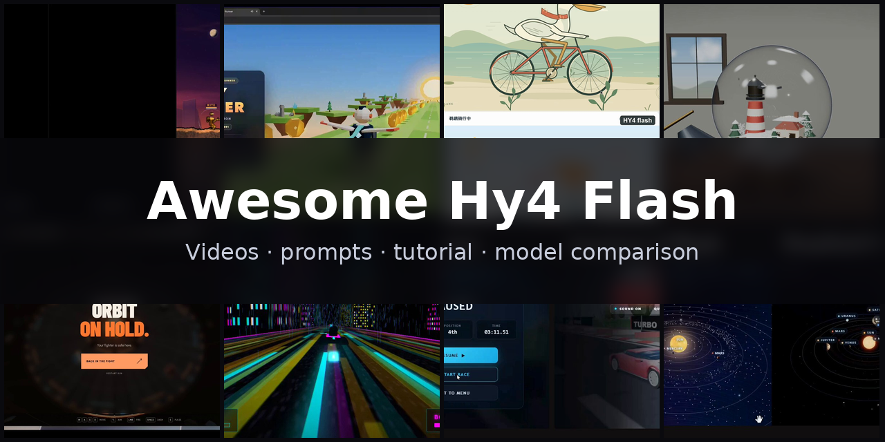](https://www.sandbase.ai/lab/ai-videos/hy4-flash?utm_source=github&utm_medium=readme&utm_campaign=awesome-hy4-flash&utm_content=banner)

A curated list of **Hy4 Flash examples**: videos, prompts and demos made with Hy4-Flash, the cost-efficient tier of Tencent Hunyuan's Hy4 family, announced on November 16, 2026. Three.js and SVG scenes, 2D animation, 3D models, browser platformers and playable games, most of them written as one self-contained HTML page from a prompt, each one credited to its creator and linked to the original post.

**38 videos** from **33 creators** · **6** with the creator's prompt · synced daily from [SandBase Lab](https://www.sandbase.ai/lab/ai-videos/hy4-flash?utm_source=github&utm_medium=readme&utm_campaign=awesome-hy4-flash&utm_content=stats)

## Start here

| I want to… | Go to |
|---|---|
| Watch the videos | [Browse by category](#contents) below, or [play them full-size on SandBase Lab](https://www.sandbase.ai/lab/ai-videos/hy4-flash?utm_source=github&utm_medium=readme&utm_campaign=awesome-hy4-flash&utm_content=quickstart) |
| Copy a prompt | [Prompt index](docs/prompts.md): every video that comes with its prompt |
| Write your own prompt | [Prompt guide](docs/prompt-guide.md): 6 patterns and a fill-in template |
| Make a video | [Tutorial](docs/tutorial.md): prompt → HTML → MP4, with the API, the CLI and a recording script |
| Pick a model | [Hy4 Flash vs. DeepSeek V4.1 Flash 1017, Claude Opus 5.5 and Hy4](docs/model-comparison.md) |
| Try it now | [Run Hy4 Flash in the Lab arena](https://www.sandbase.ai/arena/text?models=tencent%2Fhy4-flash&utm_source=github&utm_medium=readme&utm_campaign=awesome-hy4-flash&utm_content=quickstart), next to other models |

<a id="contents"></a>

## Contents

- [Featured](#featured) (6)
- [3D scenes](#3d-scene) (5)
- [Motion graphics](#motion-graphics) (4)
- [Games](#game) (7)
- [Explainers](#explainer) (1)
- [Tests & comparisons](#comparison) (21)
- [Recreate a video with Hy4 Flash](#recreate)
- [FAQ](#faq)
- [Suggest a video](#contribute)

Click a preview to play the video. Click a title for the post, the prompt and **Recreate** on SandBase Lab. **@handle** links to the creator's post on X.

<a id="featured"></a>

## Featured

<table>
<tr><td width="33%" valign="top"><a href="https://www.sandbase.ai/lab/media/x/hy4-flash/2122201963412795535/video.mp4"></a><br><a href="https://www.sandbase.ai/lab/ai-videos/hy4-flash/2122201963412795535?utm_source=github&utm_medium=readme&utm_campaign=awesome-hy4-flash&utm_content=card"><b>A motion graphics test using Hy4 Flash</b></a><br><sub><a href="https://x.com/airplanestar_/status/2122201963412795535">@airplanestar_</a> · 0:32</sub></td><td width="33%" valign="top"><a href="https://www.sandbase.ai/lab/media/x/hy4-flash/2122724443231293891/video.mp4">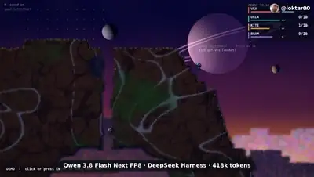</a><br><a href="https://www.sandbase.ai/lab/ai-videos/hy4-flash/2122724443231293891?utm_source=github&utm_medium=readme&utm_campaign=awesome-hy4-flash&utm_content=card"><b>Little game with destructible terrain</b></a><br><sub><a href="https://x.com/loktar00/status/2122724443231293891">@loktar00</a> · 0:36</sub></td><td width="33%" valign="top"><a href="https://www.sandbase.ai/lab/media/x/hy4-flash/2122902579453800476/video.mp4">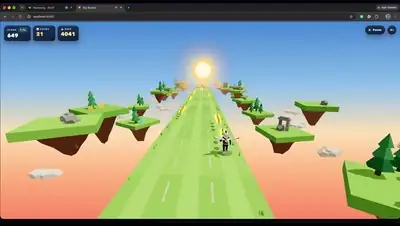</a><br><a href="https://www.sandbase.ai/lab/ai-videos/hy4-flash/2122902579453800476?utm_source=github&utm_medium=readme&utm_campaign=awesome-hy4-flash&utm_content=card"><b>Playable 3D browser game built with Three.js</b></a><br><sub><a href="https://x.com/ai_for_success/status/2122902579453800476">@ai_for_success</a> · 0:35</sub></td></tr>
<tr><td width="33%" valign="top"><a href="https://www.sandbase.ai/lab/media/x/hy4-flash/2122350545977618841/video.mp4"></a><br><a href="https://www.sandbase.ai/lab/ai-videos/hy4-flash/2122350545977618841?utm_source=github&utm_medium=readme&utm_campaign=awesome-hy4-flash&utm_content=card"><b>SVG animation of a pelican riding a bike</b></a><br><sub><a href="https://x.com/Andy_whhh/status/2122350545977618841">@Andy_whhh</a> · 0:11 · <a href="https://www.sandbase.ai/lab/ai-videos/hy4-flash/2122350545977618841?utm_source=github&utm_medium=readme&utm_campaign=awesome-hy4-flash&utm_content=card">prompt</a></sub></td><td width="33%" valign="top"><a href="https://www.sandbase.ai/lab/media/x/hy4-flash/2122237720546132278/video.mp4">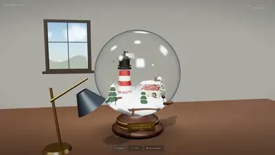</a><br><a href="https://www.sandbase.ai/lab/ai-videos/hy4-flash/2122237720546132278?utm_source=github&utm_medium=readme&utm_campaign=awesome-hy4-flash&utm_content=card"><b>Thousand Sunny and Snow Globe generation results</b></a><br><sub><a href="https://x.com/PokeBenchTV/status/2122237720546132278">@PokeBenchTV</a> · 0:20</sub></td><td width="33%" valign="top"><a href="https://www.sandbase.ai/lab/media/x/hy4-flash/2122494161236451618/video.mp4"></a><br><a href="https://www.sandbase.ai/lab/ai-videos/hy4-flash/2122494161236451618?utm_source=github&utm_medium=readme&utm_campaign=awesome-hy4-flash&utm_content=card"><b>Weekly AI news roundup and regulatory updates</b></a><br><sub><a href="https://x.com/Romka2x/status/2122494161236451618">@Romka2x</a> · 2:28</sub></td></tr>
</table>

<a id="3d-scene"></a>

## 3D scenes

<table>
<tr><td width="33%" valign="top"><a href="https://www.sandbase.ai/lab/media/x/hy4-flash/2122237720546132278/video.mp4"></a><br><a href="https://www.sandbase.ai/lab/ai-videos/hy4-flash/2122237720546132278?utm_source=github&utm_medium=readme&utm_campaign=awesome-hy4-flash&utm_content=card"><b>Thousand Sunny and Snow Globe generation results</b></a><br><sub><a href="https://x.com/PokeBenchTV/status/2122237720546132278">@PokeBenchTV</a> · 0:20</sub></td><td width="33%" valign="top"><a href="https://www.sandbase.ai/lab/media/x/hy4-flash/2122289558117327113/video.mp4">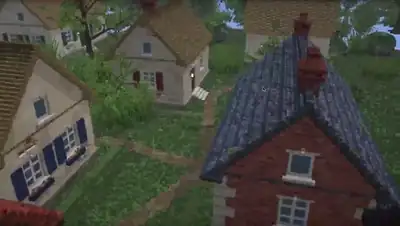</a><br><a href="https://www.sandbase.ai/lab/ai-videos/hy4-flash/2122289558117327113?utm_source=github&utm_medium=readme&utm_campaign=awesome-hy4-flash&utm_content=card"><b>A voxel demo generated by Hy4 Flash</b></a><br><sub><a href="https://x.com/dee_naliaks/status/2122289558117327113">@dee_naliaks</a> · 0:18</sub></td><td width="33%" valign="top"><a href="https://www.sandbase.ai/lab/media/x/hy4-flash/2122411723936485494/video.mp4">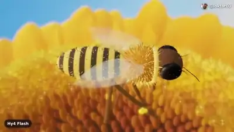</a><br><a href="https://www.sandbase.ai/lab/ai-videos/hy4-flash/2122411723936485494?utm_source=github&utm_medium=readme&utm_campaign=awesome-hy4-flash&utm_content=card"><b>A bee generated with Hy4-Flash model</b></a><br><sub><a href="https://x.com/loktar00/status/2122411723936485494">@loktar00</a> · 0:30 · <a href="https://www.sandbase.ai/lab/ai-videos/hy4-flash/2122411723936485494?utm_source=github&utm_medium=readme&utm_campaign=awesome-hy4-flash&utm_content=card">prompt</a></sub></td></tr>
<tr><td width="33%" valign="top"><a href="https://www.sandbase.ai/lab/media/x/qwen4-max/2122720684023615747/video.mp4">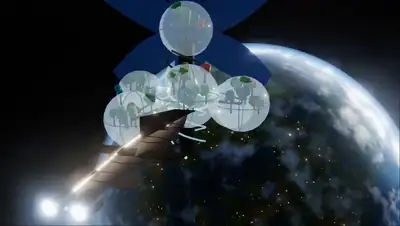</a><br><a href="https://www.sandbase.ai/lab/ai-videos/hy4-flash/2122720684023615747?utm_source=github&utm_medium=readme&utm_campaign=awesome-hy4-flash&utm_content=card"><b>Three.js HTML page generation speed test</b></a><br><sub><a href="https://x.com/beyondwudan/status/2122720684023615747">@beyondwudan</a> · 0:48</sub></td><td width="33%" valign="top"><a href="https://www.sandbase.ai/lab/media/x/deepseek-v4-1-flash-1017/2122921428576354382/video.mp4">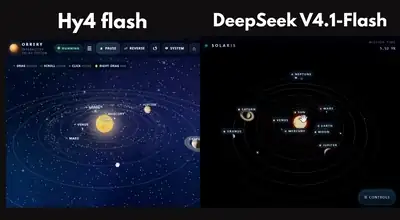</a><br><a href="https://www.sandbase.ai/lab/ai-videos/hy4-flash/2122921428576354382?utm_source=github&utm_medium=readme&utm_campaign=awesome-hy4-flash&utm_content=card"><b>Interactive 3D model of the solar system</b></a><br><sub><a href="https://x.com/s_mohinii/status/2122921428576354382">@s_mohinii</a> · 1:08</sub></td></tr>
</table>

<a id="motion-graphics"></a>

## Motion graphics

<table>
<tr><td width="33%" valign="top"><a href="https://www.sandbase.ai/lab/media/x/hy4-flash/2122201963412795535/video.mp4"></a><br><a href="https://www.sandbase.ai/lab/ai-videos/hy4-flash/2122201963412795535?utm_source=github&utm_medium=readme&utm_campaign=awesome-hy4-flash&utm_content=card"><b>A motion graphics test using Hy4 Flash</b></a><br><sub><a href="https://x.com/airplanestar_/status/2122201963412795535">@airplanestar_</a> · 0:32</sub></td><td width="33%" valign="top"><a href="https://www.sandbase.ai/lab/media/x/hy4-flash/2122350545977618841/video.mp4"></a><br><a href="https://www.sandbase.ai/lab/ai-videos/hy4-flash/2122350545977618841?utm_source=github&utm_medium=readme&utm_campaign=awesome-hy4-flash&utm_content=card"><b>SVG animation of a pelican riding a bike</b></a><br><sub><a href="https://x.com/Andy_whhh/status/2122350545977618841">@Andy_whhh</a> · 0:11 · <a href="https://www.sandbase.ai/lab/ai-videos/hy4-flash/2122350545977618841?utm_source=github&utm_medium=readme&utm_campaign=awesome-hy4-flash&utm_content=card">prompt</a></sub></td><td width="33%" valign="top"><a href="https://www.sandbase.ai/lab/media/x/hy4-flash/2122493055802495285/video.mp4"></a><br><a href="https://www.sandbase.ai/lab/ai-videos/hy4-flash/2122493055802495285?utm_source=github&utm_medium=readme&utm_campaign=awesome-hy4-flash&utm_content=card"><b>One-shot generation test with Hy4 Flash</b></a><br><sub><a href="https://x.com/MichaelGannotti/status/2122493055802495285">@MichaelGannotti</a> · 0:52</sub></td></tr>
<tr><td width="33%" valign="top"><a href="https://www.sandbase.ai/lab/media/x/hy4-flash/2122523134200799602/video.mp4"></a><br><a href="https://www.sandbase.ai/lab/ai-videos/hy4-flash/2122523134200799602?utm_source=github&utm_medium=readme&utm_campaign=awesome-hy4-flash&utm_content=card"><b>Hy4 Flash on SMF Works Cold Iron</b></a><br><sub><a href="https://x.com/MichaelGannotti/status/2122523134200799602">@MichaelGannotti</a> · 1:43</sub></td></tr>
</table>

<a id="game"></a>

## Games

<table>
<tr><td width="33%" valign="top"><a href="https://www.sandbase.ai/lab/media/x/hy4-flash/2122289568615723264/video.mp4">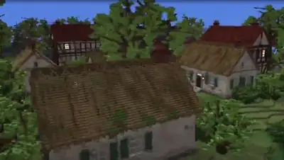</a><br><a href="https://www.sandbase.ai/lab/ai-videos/hy4-flash/2122289568615723264?utm_source=github&utm_medium=readme&utm_campaign=awesome-hy4-flash&utm_content=card"><b>A 3D game scene generated by Hy4 Flash</b></a><br><sub><a href="https://x.com/RebeccahAdson/status/2122289568615723264">@RebeccahAdson</a> · 0:21</sub></td><td width="33%" valign="top"><a href="https://www.sandbase.ai/lab/media/x/deepseek-v4-1-flash-1017/2122590824466645483/video.mp4">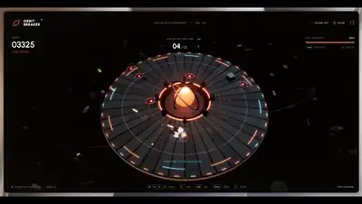</a><br><a href="https://www.sandbase.ai/lab/ai-videos/hy4-flash/2122590824466645483?utm_source=github&utm_medium=readme&utm_campaign=awesome-hy4-flash&utm_content=card"><b>Playable 3D browser arcade shooter game</b></a><br><sub><a href="https://x.com/mikenevermiss/status/2122590824466645483">@mikenevermiss</a> · 1:00</sub></td><td width="33%" valign="top"><a href="https://www.sandbase.ai/lab/media/x/deepseek-v4-1-flash-1017/2122621650915246460/video.mp4">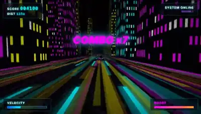</a><br><a href="https://www.sandbase.ai/lab/ai-videos/hy4-flash/2122621650915246460?utm_source=github&utm_medium=readme&utm_campaign=awesome-hy4-flash&utm_content=card"><b>A cyberpunk racing game coded by AI</b></a><br><sub><a href="https://x.com/Allexa_AI/status/2122621650915246460">@Allexa_AI</a> · 0:24</sub></td></tr>
<tr><td width="33%" valign="top"><a href="https://www.sandbase.ai/lab/media/x/hy4-flash/2122724443231293891/video.mp4"></a><br><a href="https://www.sandbase.ai/lab/ai-videos/hy4-flash/2122724443231293891?utm_source=github&utm_medium=readme&utm_campaign=awesome-hy4-flash&utm_content=card"><b>Little game with destructible terrain</b></a><br><sub><a href="https://x.com/loktar00/status/2122724443231293891">@loktar00</a> · 0:36</sub></td><td width="33%" valign="top"><a href="https://www.sandbase.ai/lab/media/x/hy4-flash/2122902579453800476/video.mp4"></a><br><a href="https://www.sandbase.ai/lab/ai-videos/hy4-flash/2122902579453800476?utm_source=github&utm_medium=readme&utm_campaign=awesome-hy4-flash&utm_content=card"><b>Playable 3D browser game built with Three.js</b></a><br><sub><a href="https://x.com/ai_for_success/status/2122902579453800476">@ai_for_success</a> · 0:35</sub></td><td width="33%" valign="top"><a href="https://www.sandbase.ai/lab/media/x/deepseek-v4-1-flash-1017/2122919755841757479/video.mp4">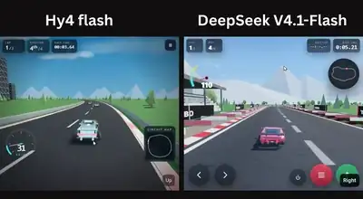</a><br><a href="https://www.sandbase.ai/lab/ai-videos/hy4-flash/2122919755841757479?utm_source=github&utm_medium=readme&utm_campaign=awesome-hy4-flash&utm_content=card"><b>Playable 3D car racing game</b></a><br><sub><a href="https://x.com/riyazmd774/status/2122919755841757479">@riyazmd774</a> · 0:40</sub></td></tr>
</table>

<details>
<summary><b>Show all 7</b></summary>

<table>
<tr><td width="33%" valign="top"><a href="https://www.sandbase.ai/lab/media/x/hy4-flash/2123085293414916457/video.mp4">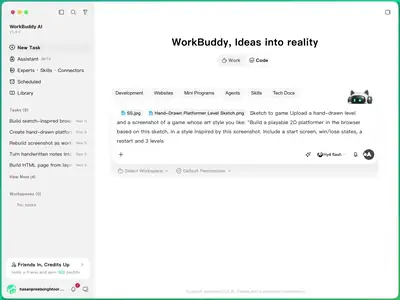</a><br><a href="https://www.sandbase.ai/lab/ai-videos/hy4-flash/2123085293414916457?utm_source=github&utm_medium=readme&utm_campaign=awesome-hy4-flash&utm_content=card"><b>Browser platformer game generated from a paper sketch</b></a><br><sub><a href="https://x.com/hasantoxr/status/2123085293414916457">@hasantoxr</a> · 0:56 · <a href="https://www.sandbase.ai/lab/ai-videos/hy4-flash/2123085293414916457?utm_source=github&utm_medium=readme&utm_campaign=awesome-hy4-flash&utm_content=card">prompt</a></sub></td></tr>
</table>

</details>

<a id="explainer"></a>

## Explainers

<table>
<tr><td width="33%" valign="top"><a href="https://www.sandbase.ai/lab/media/x/hy4-flash/2122494161236451618/video.mp4"></a><br><a href="https://www.sandbase.ai/lab/ai-videos/hy4-flash/2122494161236451618?utm_source=github&utm_medium=readme&utm_campaign=awesome-hy4-flash&utm_content=card"><b>Weekly AI news roundup and regulatory updates</b></a><br><sub><a href="https://x.com/Romka2x/status/2122494161236451618">@Romka2x</a> · 2:28</sub></td></tr>
</table>

<a id="comparison"></a>

## Tests & comparisons

<table>
<tr><td width="33%" valign="top"><a href="https://www.sandbase.ai/lab/media/x/hy4-flash/2122257048184455329/video.mp4">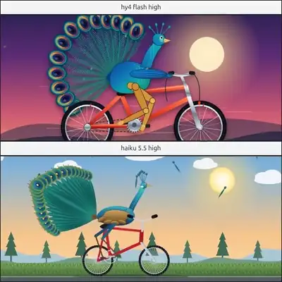</a><br><a href="https://www.sandbase.ai/lab/ai-videos/hy4-flash/2122257048184455329?utm_source=github&utm_medium=readme&utm_campaign=awesome-hy4-flash&utm_content=card"><b>Peacock SVG benchmark comparing Hy4 and Claude</b></a><br><sub><a href="https://x.com/SahilPanhotra/status/2122257048184455329">@SahilPanhotra</a> · 0:10</sub></td><td width="33%" valign="top"><a href="https://www.sandbase.ai/lab/media/x/hy4-flash/2122289623837896727/video.mp4">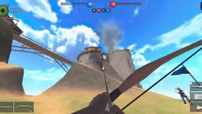</a><br><a href="https://www.sandbase.ai/lab/ai-videos/hy4-flash/2122289623837896727?utm_source=github&utm_medium=readme&utm_campaign=awesome-hy4-flash&utm_content=card"><b>Comparing Hy4 Flash and Hy4 model game output</b></a><br><sub><a href="https://x.com/kate_osita_/status/2122289623837896727">@kate_osita_</a> · 1:10</sub></td><td width="33%" valign="top"><a href="https://www.sandbase.ai/lab/media/x/hy4-flash/2122315149029826951/video.mp4">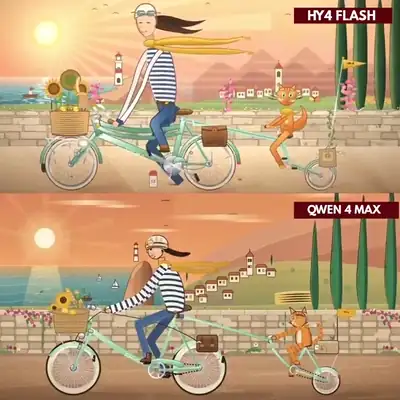</a><br><a href="https://www.sandbase.ai/lab/ai-videos/hy4-flash/2122315149029826951?utm_source=github&utm_medium=readme&utm_campaign=awesome-hy4-flash&utm_content=card"><b>Comparing Hy4 Flash and Qwen 4 SVG animation</b></a><br><sub><a href="https://x.com/marcthecreatorr/status/2122315149029826951">@marcthecreatorr</a> · 0:12</sub></td></tr>
<tr><td width="33%" valign="top"><a href="https://www.sandbase.ai/lab/media/x/hy4-flash/2122415420665921735/video.mp4">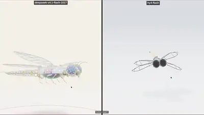</a><br><a href="https://www.sandbase.ai/lab/ai-videos/hy4-flash/2122415420665921735?utm_source=github&utm_medium=readme&utm_campaign=awesome-hy4-flash&utm_content=card"><b>Mechanical dragonfly comparison between Hy4-Flash and DeepSeek-v4.1</b></a><br><sub><a href="https://x.com/ItsmeAjayKV/status/2122415420665921735">@ItsmeAjayKV</a> · 0:34 · <a href="https://www.sandbase.ai/lab/ai-videos/hy4-flash/2122415420665921735?utm_source=github&utm_medium=readme&utm_campaign=awesome-hy4-flash&utm_content=card">prompt</a></sub></td><td width="33%" valign="top"><a href="https://www.sandbase.ai/lab/media/x/hy4-flash/2122429321151435237/video.mp4">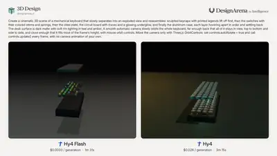</a><br><a href="https://www.sandbase.ai/lab/ai-videos/hy4-flash/2122429321151435237?utm_source=github&utm_medium=readme&utm_campaign=awesome-hy4-flash&utm_content=card"><b>Mechanical keyboard disassembly comparison between Hy4 and Hy4-Flash</b></a><br><sub><a href="https://x.com/DesignArena/status/2122429321151435237">@DesignArena</a> · 0:12 · <a href="https://www.sandbase.ai/lab/ai-videos/hy4-flash/2122429321151435237?utm_source=github&utm_medium=readme&utm_campaign=awesome-hy4-flash&utm_content=card">prompt</a></sub></td><td width="33%" valign="top"><a href="https://www.sandbase.ai/lab/media/x/hy4-flash/2122450891613868137/video.mp4">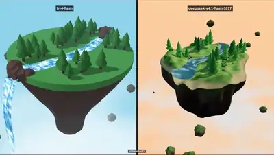</a><br><a href="https://www.sandbase.ai/lab/ai-videos/hy4-flash/2122450891613868137?utm_source=github&utm_medium=readme&utm_campaign=awesome-hy4-flash&utm_content=card"><b>Three.js terrain scene comparison between two models</b></a><br><sub><a href="https://x.com/ItsmeAjayKV/status/2122450891613868137">@ItsmeAjayKV</a> · 0:36</sub></td></tr>
</table>

<details>
<summary><b>Show all 21</b></summary>

<table>
<tr><td width="33%" valign="top"><a href="https://www.sandbase.ai/lab/media/x/hy4-flash/2122481844578881884/video.mp4">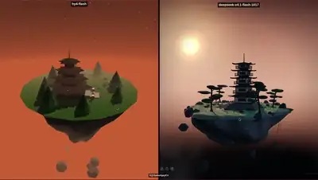</a><br><a href="https://www.sandbase.ai/lab/ai-videos/hy4-flash/2122481844578881884?utm_source=github&utm_medium=readme&utm_campaign=awesome-hy4-flash&utm_content=card"><b>One-shot model performance comparison</b></a><br><sub><a href="https://x.com/ItsmeAjayKV/status/2122481844578881884">@ItsmeAjayKV</a> · 0:36</sub></td><td width="33%" valign="top"><a href="https://www.sandbase.ai/lab/media/x/qwen4-max/2122484469215158409/video.mp4">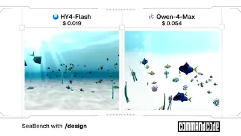</a><br><a href="https://www.sandbase.ai/lab/ai-videos/hy4-flash/2122484469215158409?utm_source=github&utm_medium=readme&utm_campaign=awesome-hy4-flash&utm_content=card"><b>3D visual benchmark across two AI models</b></a><br><sub><a href="https://x.com/naymur_dev/status/2122484469215158409">@naymur_dev</a> · 0:37</sub></td><td width="33%" valign="top"><a href="https://www.sandbase.ai/lab/media/x/deepseek-v4-1-flash-1017/2122493755697844338/video.mp4"></a><br><a href="https://www.sandbase.ai/lab/ai-videos/hy4-flash/2122493755697844338?utm_source=github&utm_medium=readme&utm_campaign=awesome-hy4-flash&utm_content=card"><b>Hy4 Flash versus DeepSeek V4.1 Flash</b></a><br><sub><a href="https://x.com/Jbm_dev/status/2122493755697844338">@Jbm_dev</a> · 1:03</sub></td></tr>
<tr><td width="33%" valign="top"><a href="https://www.sandbase.ai/lab/media/x/hy4-flash/2122502480592240816/video.mp4"></a><br><a href="https://www.sandbase.ai/lab/ai-videos/hy4-flash/2122502480592240816?utm_source=github&utm_medium=readme&utm_campaign=awesome-hy4-flash&utm_content=card"><b>Flying car 3D animation model comparison</b></a><br><sub><a href="https://x.com/willwang_xx/status/2122502480592240816">@willwang_xx</a> · 0:37</sub></td><td width="33%" valign="top"><a href="https://www.sandbase.ai/lab/media/x/hy4-flash/2122596232237625472/video.mp4">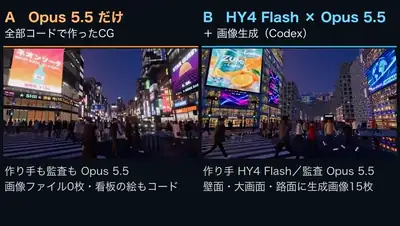</a><br><a href="https://www.sandbase.ai/lab/ai-videos/hy4-flash/2122596232237625472?utm_source=github&utm_medium=readme&utm_campaign=awesome-hy4-flash&utm_content=card"><b>Three.js scramble crossing 3D scene comparison</b></a><br><sub><a href="https://x.com/K1sqttPHfC41982/status/2122596232237625472">@K1sqttPHfC41982</a> · 0:24</sub></td><td width="33%" valign="top"><a href="https://www.sandbase.ai/lab/media/x/deepseek-v4-1-flash-1017/2122624548076228895/video.mp4">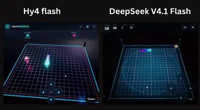</a><br><a href="https://www.sandbase.ai/lab/ai-videos/hy4-flash/2122624548076228895?utm_source=github&utm_medium=readme&utm_campaign=awesome-hy4-flash&utm_content=card"><b>Playable 3D Snake game comparison</b></a><br><sub><a href="https://x.com/shabnam_774/status/2122624548076228895">@shabnam_774</a> · 0:37</sub></td></tr>
<tr><td width="33%" valign="top"><a href="https://www.sandbase.ai/lab/media/x/deepseek-v4-1-flash-1017/2122644820711645328/video.mp4">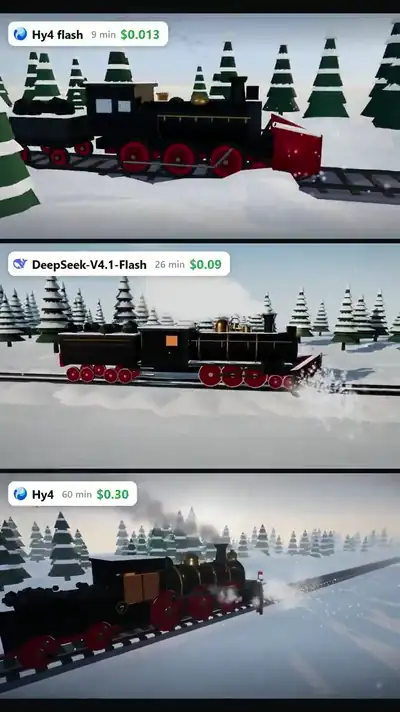</a><br><a href="https://www.sandbase.ai/lab/ai-videos/hy4-flash/2122644820711645328?utm_source=github&utm_medium=readme&utm_campaign=awesome-hy4-flash&utm_content=card"><b>Winter railway locomotive scene model comparison</b></a><br><sub><a href="https://x.com/0x_fokki/status/2122644820711645328">@0x_fokki</a> · 0:12</sub></td><td width="33%" valign="top"><a href="https://www.sandbase.ai/lab/media/x/hy4-flash/2122653322775769441/video.mp4">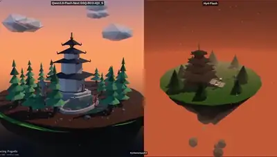</a><br><a href="https://www.sandbase.ai/lab/ai-videos/hy4-flash/2122653322775769441?utm_source=github&utm_medium=readme&utm_campaign=awesome-hy4-flash&utm_content=card"><b>Comparison of Qwen and Hy4 flash models</b></a><br><sub><a href="https://x.com/ItsmeAjayKV/status/2122653322775769441">@ItsmeAjayKV</a> · 0:34</sub></td><td width="33%" valign="top"><a href="https://www.sandbase.ai/lab/media/x/deepseek-v4-1-flash-1017/2122684074787778616/video.mp4">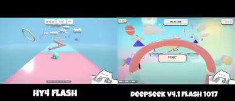</a><br><a href="https://www.sandbase.ai/lab/ai-videos/hy4-flash/2122684074787778616?utm_source=github&utm_medium=readme&utm_campaign=awesome-hy4-flash&utm_content=card"><b>Hy4 Flash and DeepSeek V4.1 Flash comparison</b></a><br><sub><a href="https://x.com/notjazii/status/2122684074787778616">@notjazii</a> · 0:22</sub></td></tr>
<tr><td width="33%" valign="top"><a href="https://www.sandbase.ai/lab/media/x/hy4-flash/2122728283208839285/video.mp4">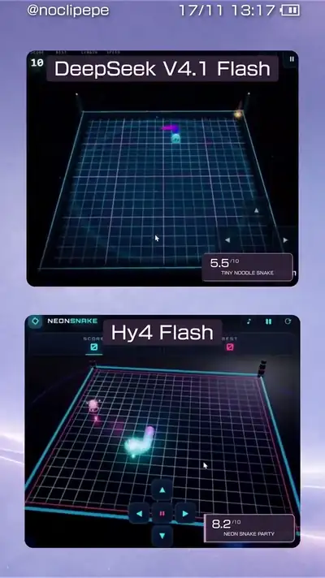</a><br><a href="https://www.sandbase.ai/lab/ai-videos/hy4-flash/2122728283208839285?utm_source=github&utm_medium=readme&utm_campaign=awesome-hy4-flash&utm_content=card"><b>3D Snake game comparison across two models</b></a><br><sub><a href="https://x.com/noclipepe/status/2122728283208839285">@noclipepe</a> · 0:41</sub></td><td width="33%" valign="top"><a href="https://www.sandbase.ai/lab/media/x/deepseek-v4-1-flash-1017/2122972249762455876/video.mp4">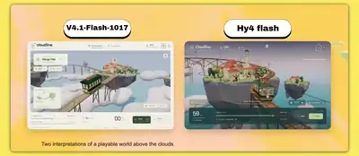</a><br><a href="https://www.sandbase.ai/lab/ai-videos/hy4-flash/2122972249762455876?utm_source=github&utm_medium=readme&utm_campaign=awesome-hy4-flash&utm_content=card"><b>Comparing performance and cost efficiency across models</b></a><br><sub><a href="https://x.com/Parul_Gautam7/status/2122972249762455876">@Parul_Gautam7</a> · 0:07</sub></td><td width="33%" valign="top"><a href="https://www.sandbase.ai/lab/media/x/deepseek-v4-1-flash-1017/2122995650727985153/video.mp4">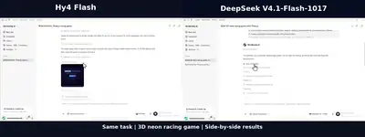</a><br><a href="https://www.sandbase.ai/lab/ai-videos/hy4-flash/2122995650727985153?utm_source=github&utm_medium=readme&utm_campaign=awesome-hy4-flash&utm_content=card"><b>Playable 3D racing game comparison between models</b></a><br><sub><a href="https://x.com/JacobyoungAI/status/2122995650727985153">@JacobyoungAI</a> · 0:33</sub></td></tr>
<tr><td width="33%" valign="top"><a href="https://www.sandbase.ai/lab/media/x/gemini-4-hydrogen/2123028120483901925/video.mp4">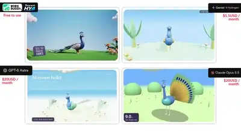</a><br><a href="https://www.sandbase.ai/lab/ai-videos/hy4-flash/2123028120483901925?utm_source=github&utm_medium=readme&utm_campaign=awesome-hy4-flash&utm_content=card"><b>Peacock dance animation comparison across multiple models</b></a><br><sub><a href="https://x.com/CodeByPoonam/status/2123028120483901925">@CodeByPoonam</a> · 0:15 · <a href="https://www.sandbase.ai/lab/ai-videos/hy4-flash/2123028120483901925?utm_source=github&utm_medium=readme&utm_campaign=awesome-hy4-flash&utm_content=card">prompt</a></sub></td><td width="33%" valign="top"><a href="https://www.sandbase.ai/lab/media/x/deepseek-v4-1-flash-1017/2123085268416856398/video.mp4">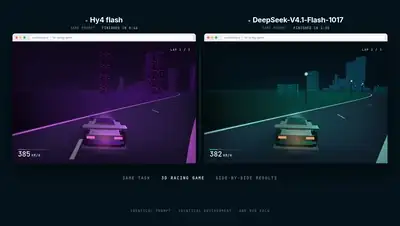</a><br><a href="https://www.sandbase.ai/lab/ai-videos/hy4-flash/2123085268416856398?utm_source=github&utm_medium=readme&utm_campaign=awesome-hy4-flash&utm_content=card"><b>Side-by-side 3D racing game generation comparison</b></a><br><sub><a href="https://x.com/FellMentKE/status/2123085268416856398">@FellMentKE</a> · 0:20</sub></td><td width="33%" valign="top"><a href="https://www.sandbase.ai/lab/media/x/deepseek-v4-1-flash-1017/2123085937647505658/video.mp4">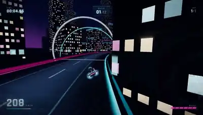</a><br><a href="https://www.sandbase.ai/lab/ai-videos/hy4-flash/2123085937647505658?utm_source=github&utm_medium=readme&utm_campaign=awesome-hy4-flash&utm_content=card"><b>Hoverbike time attack video through a neon city</b></a><br><sub><a href="https://x.com/n__deborah/status/2123085937647505658">@n__deborah</a> · 0:24</sub></td></tr>
</table>

</details>

**[See all 38 on SandBase Lab →](https://www.sandbase.ai/lab/ai-videos/hy4-flash?utm_source=github&utm_medium=readme&utm_campaign=awesome-hy4-flash&utm_content=section)**

<a id="recreate"></a>

## Recreate a video with Hy4 Flash

Every video page on [SandBase Lab](https://www.sandbase.ai/lab/ai-videos/hy4-flash?utm_source=github&utm_medium=readme&utm_campaign=awesome-hy4-flash&utm_content=recreate) has a **Recreate** button: it sends the post to Hy4 Flash in the Lab text arena and returns the code, ready to play in the browser.

With the API, Hy4 Flash is `tencent/hy4-flash` on SandBase (OpenAI-compatible). Put a prompt in `prompt.txt`, create a key in the [console](https://www.sandbase.ai/console/keys?utm_source=github&utm_medium=readme&utm_campaign=awesome-hy4-flash), and run:

```bash
jq -n --rawfile prompt prompt.txt \
  '{model: "tencent/hy4-flash", max_tokens: 64000, messages: [{role: "user", content: $prompt}]}' |
curl -sS --max-time 900 https://api.sandbase.ai/v1/chat/completions \
  -H "Authorization: Bearer $SANDBASE_API_KEY" \
  -H "Content-Type: application/json" \
  -d @- | jq -r '.choices[0].message.content' | sed '/^```/d' > hy4-flash.html
```

Open `hy4-flash.html` in a browser, or run it in a [SandBase Sandbox](https://www.sandbase.ai/landing/sandbox?utm_source=github&utm_medium=readme&utm_campaign=awesome-hy4-flash) to keep generated code isolated. `max_tokens` is capped at 64,000 for this model, so the call above asks for that maximum. Full walkthrough: [tutorial](docs/tutorial.md). Pricing: [model page](https://www.sandbase.ai/model/tencent/hy4-flash?utm_source=github&utm_medium=readme&utm_campaign=awesome-hy4-flash).

<a id="faq"></a>

## FAQ

### What is Hy4 Flash?

Hy4-Flash is the cost-efficient tier of Tencent Hunyuan's Hy4 family, announced on November 16, 2026, with roughly a quarter of the flagship's parameters. It accepts text and image input, has a context window of about 1,048,576 tokens, and supports reasoning, tool calling and structured output. On SandBase it is `tencent/hy4-flash`, priced at $0.07 per million input tokens and $0.281 per million output tokens. Source: `sandbase inspect tencent/hy4-flash`.

### How are these Hy4 Flash videos made?

The model doesn't render video. It writes a web page (HTML with Three.js, SVG, Canvas or CSS animation), and the creator records the page playing. Creators ran it one-shot, without a harness, and some compared it against other models on the same prompt. See the [tutorial](docs/tutorial.md).

### Where do I find the prompt for a video?

Videos tagged **prompt** come with the creator's prompt on their Lab page. The [prompt index](docs/prompts.md) lists all of them.

### How do I write a good Hy4 Flash prompt?

Name one self-contained HTML file and the renderer you want (Three.js, SVG, Canvas or CSS), describe the subject and the motion, and ban external assets. Creators who shared prompts kept them to one concrete subject, such as a mechanical dragonfly or a keyboard that disassembles layer by layer. Details and a template: [prompt guide](docs/prompt-guide.md).

### How do I use the Hy4 Flash API?

On SandBase the model id is `tencent/hy4-flash` on the OpenAI-compatible `/v1/chat/completions` endpoint. One key works for every model. See [Recreate](#recreate) and the [model page](https://www.sandbase.ai/model/tencent/hy4-flash?utm_source=github&utm_medium=readme&utm_campaign=awesome-hy4-flash).

### Is Hy4 Flash better than DeepSeek V4.1 Flash 1017, Claude Opus 5.5 or Hy4?

There is no measured answer yet. The source bundle has no Lab Evals or Pelican Test row for Hy4 Flash, so no benchmark score is quoted here. The creator evidence is one-shot and mixed: one creator found DeepSeek V4.1 Flash 1017 more mechanical on a dragonfly test and said Hy4 Flash was more basic, while DesignArena reports that the larger Hy4 adds more detail on the same 3D prompt. Details: [model comparison](docs/model-comparison.md).

### How much does one video cost?

The list price on SandBase is $0.07 per million input tokens, $0.281 per million output tokens, and $0.003 per million cached input tokens. Creators also report Hy4 Flash free in WorkBuddy. Reasoning tokens bill as output. Source: `sandbase inspect tencent/hy4-flash`.

### Can I reuse these videos?

No, not by default. They belong to their creators. See [MEDIA-RIGHTS](MEDIA-RIGHTS.md).

<a id="contribute"></a>

## Suggest a video

Know a Hy4 Flash creation that should be here? [Open a submission](https://github.com/sandbase-lab/awesome-hy4-flash/issues/new?template=submit-video.yml) with the original X post. Accepted posts are added on SandBase Lab and show up here on the next daily sync. If this list helped you, a ⭐ helps others find it.

## Credits & rights

Every video, prompt and post belongs to its creator. Cards credit the author and link to the original post. The MIT license covers this repository's scripts only. To correct a credit or remove a video, see [MEDIA-RIGHTS](MEDIA-RIGHTS.md).

Not affiliated with or endorsed by Tencent Hunyuan.

---

Maintained by [SandBase Lab](https://www.sandbase.ai/lab/?utm_source=github&utm_medium=readme&utm_campaign=awesome-hy4-flash) · [All AI video collections](https://www.sandbase.ai/lab/ai-videos?utm_source=github&utm_medium=readme&utm_campaign=awesome-hy4-flash)
