# Awesome Hy4 Flash

[English](README.md) · 简体中文

[](https://awesome.re) [](#contents) [](docs/zh-CN/prompts.md) [](https://github.com/sandbase-lab/awesome-hy4-flash/actions/workflows/sync.yml) [](https://www.sandbase.ai/model/tencent/hy4-flash?utm_source=github&utm_medium=readme&utm_campaign=awesome-hy4-flash)

[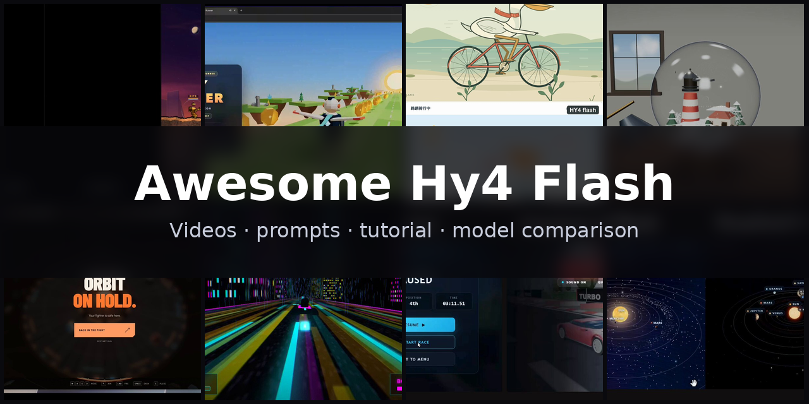](https://www.sandbase.ai/lab/ai-videos/hy4-flash?lang=zh-CN&utm_source=github&utm_medium=readme&utm_campaign=awesome-hy4-flash&utm_content=banner)

精选 **Hy4 Flash 案例**合集：用 Hy4-Flash（腾讯混元 Hy4 系列中性价比更高的一档，2026 年 11 月 16 日发布）做出的视频、提示词和演示。包括 Three.js 与 SVG 场景、2D 动画、3D 模型、浏览器平台跳跃游戏和可以直接玩的游戏，大多是模型根据提示词写成的单文件网页，均注明作者并链接原帖。

共 **38 条视频**，来自 **33 位创作者** · **6 条**附作者提示词 · 每天从 [SandBase Lab](https://www.sandbase.ai/lab/ai-videos/hy4-flash?lang=zh-CN&utm_source=github&utm_medium=readme&utm_campaign=awesome-hy4-flash&utm_content=stats) 同步

## 从这里开始

| 我想… | 去这里 |
|---|---|
| 看视频 | 在下方 [按分类浏览](#contents)，或 [在 SandBase Lab 大屏播放](https://www.sandbase.ai/lab/ai-videos/hy4-flash?lang=zh-CN&utm_source=github&utm_medium=readme&utm_campaign=awesome-hy4-flash&utm_content=quickstart) |
| 复制提示词 | [提示词索引](docs/zh-CN/prompts.md)：所有附带提示词的视频 |
| 自己写提示词 | [提示词写法](docs/zh-CN/prompt-guide.md)：6 条写法和一个填空模板 |
| 做一个视频 | [教程](docs/zh-CN/tutorial.md)：提示词 → HTML → MP4，含 API、CLI 调用和录屏脚本 |
| 选模型 | [Hy4 Flash 对比 DeepSeek V4.1 Flash 1017、Claude Opus 5.5 和 Hy4](docs/zh-CN/model-comparison.md) |
| 马上试试 | [在 Lab 竞技场运行 Hy4 Flash](https://www.sandbase.ai/arena/text?models=tencent%2Fhy4-flash&lang=zh-CN&utm_source=github&utm_medium=readme&utm_campaign=awesome-hy4-flash&utm_content=quickstart)，和其他模型并排对比 |

<a id="contents"></a>

## 目录

- [精选](#featured) (6)
- [3D 场景](#3d-scene) (5)
- [动效](#motion-graphics) (4)
- [游戏](#game) (7)
- [讲解](#explainer) (1)
- [测试对比](#comparison) (21)
- [用 Hy4 Flash 复刻视频](#recreate)
- [常见问题](#faq)
- [推荐作品](#contribute)

点击预览图播放视频；点击标题前往 SandBase Lab 查看原帖、提示词，并一键 **复刻**；**@作者** 链接到 X 原帖。

<a id="featured"></a>

## 精选

<table>
<tr><td width="33%" valign="top"><a href="https://www.sandbase.ai/lab/media/x/hy4-flash/2122201963412795535/video.mp4"></a><br><a href="https://www.sandbase.ai/lab/ai-videos/hy4-flash/2122201963412795535?lang=zh-CN&utm_source=github&utm_medium=readme&utm_campaign=awesome-hy4-flash&utm_content=card"><b>使用Hy4 Flash制作的动态图形测试</b></a><br><sub><a href="https://x.com/airplanestar_/status/2122201963412795535">@airplanestar_</a> · 0:32</sub></td><td width="33%" valign="top"><a href="https://www.sandbase.ai/lab/media/x/hy4-flash/2122724443231293891/video.mp4">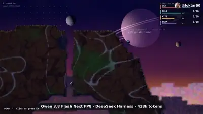</a><br><a href="https://www.sandbase.ai/lab/ai-videos/hy4-flash/2122724443231293891?lang=zh-CN&utm_source=github&utm_medium=readme&utm_campaign=awesome-hy4-flash&utm_content=card"><b>可破坏地形的轻量小游戏</b></a><br><sub><a href="https://x.com/loktar00/status/2122724443231293891">@loktar00</a> · 0:36</sub></td><td width="33%" valign="top"><a href="https://www.sandbase.ai/lab/media/x/hy4-flash/2122902579453800476/video.mp4">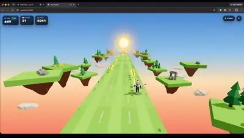</a><br><a href="https://www.sandbase.ai/lab/ai-videos/hy4-flash/2122902579453800476?lang=zh-CN&utm_source=github&utm_medium=readme&utm_campaign=awesome-hy4-flash&utm_content=card"><b>基于 Three.js 构建的网页三维游戏</b></a><br><sub><a href="https://x.com/ai_for_success/status/2122902579453800476">@ai_for_success</a> · 0:35</sub></td></tr>
<tr><td width="33%" valign="top"><a href="https://www.sandbase.ai/lab/media/x/hy4-flash/2122350545977618841/video.mp4">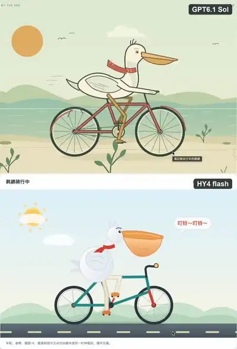</a><br><a href="https://www.sandbase.ai/lab/ai-videos/hy4-flash/2122350545977618841?lang=zh-CN&utm_source=github&utm_medium=readme&utm_campaign=awesome-hy4-flash&utm_content=card"><b>鹈鹕骑自行车的SVG动画生成效果</b></a><br><sub><a href="https://x.com/Andy_whhh/status/2122350545977618841">@Andy_whhh</a> · 0:11 · <a href="https://www.sandbase.ai/lab/ai-videos/hy4-flash/2122350545977618841?lang=zh-CN&utm_source=github&utm_medium=readme&utm_campaign=awesome-hy4-flash&utm_content=card">提示词</a></sub></td><td width="33%" valign="top"><a href="https://www.sandbase.ai/lab/media/x/hy4-flash/2122237720546132278/video.mp4">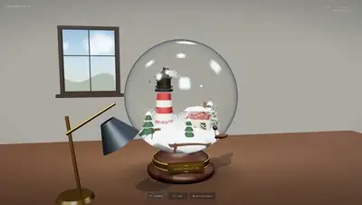</a><br><a href="https://www.sandbase.ai/lab/ai-videos/hy4-flash/2122237720546132278?lang=zh-CN&utm_source=github&utm_medium=readme&utm_campaign=awesome-hy4-flash&utm_content=card"><b>使用Hy4 Flash生成的千阳号与雪球动画</b></a><br><sub><a href="https://x.com/PokeBenchTV/status/2122237720546132278">@PokeBenchTV</a> · 0:20</sub></td><td width="33%" valign="top"><a href="https://www.sandbase.ai/lab/media/x/hy4-flash/2122494161236451618/video.mp4"></a><br><a href="https://www.sandbase.ai/lab/ai-videos/hy4-flash/2122494161236451618?lang=zh-CN&utm_source=github&utm_medium=readme&utm_campaign=awesome-hy4-flash&utm_content=card"><b>AI行业新闻与监管动态播报</b></a><br><sub><a href="https://x.com/Romka2x/status/2122494161236451618">@Romka2x</a> · 2:28</sub></td></tr>
</table>

<a id="3d-scene"></a>

## 3D 场景

<table>
<tr><td width="33%" valign="top"><a href="https://www.sandbase.ai/lab/media/x/hy4-flash/2122237720546132278/video.mp4"></a><br><a href="https://www.sandbase.ai/lab/ai-videos/hy4-flash/2122237720546132278?lang=zh-CN&utm_source=github&utm_medium=readme&utm_campaign=awesome-hy4-flash&utm_content=card"><b>使用Hy4 Flash生成的千阳号与雪球动画</b></a><br><sub><a href="https://x.com/PokeBenchTV/status/2122237720546132278">@PokeBenchTV</a> · 0:20</sub></td><td width="33%" valign="top"><a href="https://www.sandbase.ai/lab/media/x/hy4-flash/2122289558117327113/video.mp4">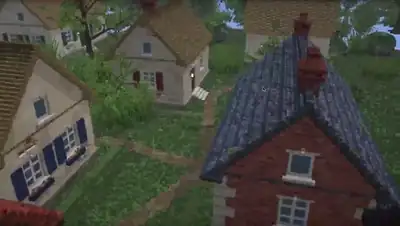</a><br><a href="https://www.sandbase.ai/lab/ai-videos/hy4-flash/2122289558117327113?lang=zh-CN&utm_source=github&utm_medium=readme&utm_campaign=awesome-hy4-flash&utm_content=card"><b>由Hy4 Flash生成的体素演示视频</b></a><br><sub><a href="https://x.com/dee_naliaks/status/2122289558117327113">@dee_naliaks</a> · 0:18</sub></td><td width="33%" valign="top"><a href="https://www.sandbase.ai/lab/media/x/hy4-flash/2122411723936485494/video.mp4">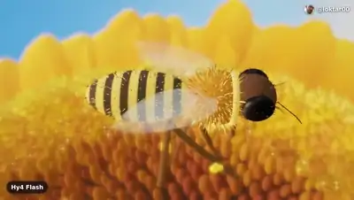</a><br><a href="https://www.sandbase.ai/lab/ai-videos/hy4-flash/2122411723936485494?lang=zh-CN&utm_source=github&utm_medium=readme&utm_campaign=awesome-hy4-flash&utm_content=card"><b>使用Hy4-Flash模型生成的蜜蜂视频</b></a><br><sub><a href="https://x.com/loktar00/status/2122411723936485494">@loktar00</a> · 0:30 · <a href="https://www.sandbase.ai/lab/ai-videos/hy4-flash/2122411723936485494?lang=zh-CN&utm_source=github&utm_medium=readme&utm_campaign=awesome-hy4-flash&utm_content=card">提示词</a></sub></td></tr>
<tr><td width="33%" valign="top"><a href="https://www.sandbase.ai/lab/media/x/qwen4-max/2122720684023615747/video.mp4">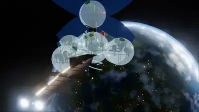</a><br><a href="https://www.sandbase.ai/lab/ai-videos/hy4-flash/2122720684023615747?lang=zh-CN&utm_source=github&utm_medium=readme&utm_campaign=awesome-hy4-flash&utm_content=card"><b>Three.js网页生成速度测试</b></a><br><sub><a href="https://x.com/beyondwudan/status/2122720684023615747">@beyondwudan</a> · 0:48</sub></td><td width="33%" valign="top"><a href="https://www.sandbase.ai/lab/media/x/deepseek-v4-1-flash-1017/2122921428576354382/video.mp4">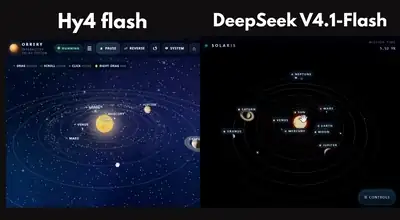</a><br><a href="https://www.sandbase.ai/lab/ai-videos/hy4-flash/2122921428576354382?lang=zh-CN&utm_source=github&utm_medium=readme&utm_campaign=awesome-hy4-flash&utm_content=card"><b>可交互的三维太阳系模型</b></a><br><sub><a href="https://x.com/s_mohinii/status/2122921428576354382">@s_mohinii</a> · 1:08</sub></td></tr>
</table>

<a id="motion-graphics"></a>

## 动效

<table>
<tr><td width="33%" valign="top"><a href="https://www.sandbase.ai/lab/media/x/hy4-flash/2122201963412795535/video.mp4"></a><br><a href="https://www.sandbase.ai/lab/ai-videos/hy4-flash/2122201963412795535?lang=zh-CN&utm_source=github&utm_medium=readme&utm_campaign=awesome-hy4-flash&utm_content=card"><b>使用Hy4 Flash制作的动态图形测试</b></a><br><sub><a href="https://x.com/airplanestar_/status/2122201963412795535">@airplanestar_</a> · 0:32</sub></td><td width="33%" valign="top"><a href="https://www.sandbase.ai/lab/media/x/hy4-flash/2122350545977618841/video.mp4"></a><br><a href="https://www.sandbase.ai/lab/ai-videos/hy4-flash/2122350545977618841?lang=zh-CN&utm_source=github&utm_medium=readme&utm_campaign=awesome-hy4-flash&utm_content=card"><b>鹈鹕骑自行车的SVG动画生成效果</b></a><br><sub><a href="https://x.com/Andy_whhh/status/2122350545977618841">@Andy_whhh</a> · 0:11 · <a href="https://www.sandbase.ai/lab/ai-videos/hy4-flash/2122350545977618841?lang=zh-CN&utm_source=github&utm_medium=readme&utm_campaign=awesome-hy4-flash&utm_content=card">提示词</a></sub></td><td width="33%" valign="top"><a href="https://www.sandbase.ai/lab/media/x/hy4-flash/2122493055802495285/video.mp4">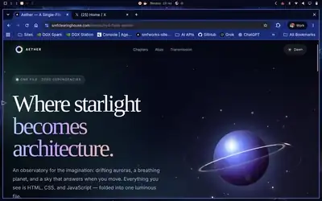</a><br><a href="https://www.sandbase.ai/lab/ai-videos/hy4-flash/2122493055802495285?lang=zh-CN&utm_source=github&utm_medium=readme&utm_campaign=awesome-hy4-flash&utm_content=card"><b>Hy4 Flash单次生成测试演示</b></a><br><sub><a href="https://x.com/MichaelGannotti/status/2122493055802495285">@MichaelGannotti</a> · 0:52</sub></td></tr>
<tr><td width="33%" valign="top"><a href="https://www.sandbase.ai/lab/media/x/hy4-flash/2122523134200799602/video.mp4"></a><br><a href="https://www.sandbase.ai/lab/ai-videos/hy4-flash/2122523134200799602?lang=zh-CN&utm_source=github&utm_medium=readme&utm_campaign=awesome-hy4-flash&utm_content=card"><b>Hy4 Flash基准测试演示视频</b></a><br><sub><a href="https://x.com/MichaelGannotti/status/2122523134200799602">@MichaelGannotti</a> · 1:43</sub></td></tr>
</table>

<a id="game"></a>

## 游戏

<table>
<tr><td width="33%" valign="top"><a href="https://www.sandbase.ai/lab/media/x/hy4-flash/2122289568615723264/video.mp4">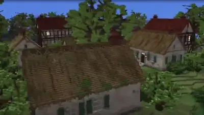</a><br><a href="https://www.sandbase.ai/lab/ai-videos/hy4-flash/2122289568615723264?lang=zh-CN&utm_source=github&utm_medium=readme&utm_campaign=awesome-hy4-flash&utm_content=card"><b>由Hy4 Flash生成的3D游戏场景</b></a><br><sub><a href="https://x.com/RebeccahAdson/status/2122289568615723264">@RebeccahAdson</a> · 0:21</sub></td><td width="33%" valign="top"><a href="https://www.sandbase.ai/lab/media/x/deepseek-v4-1-flash-1017/2122590824466645483/video.mp4">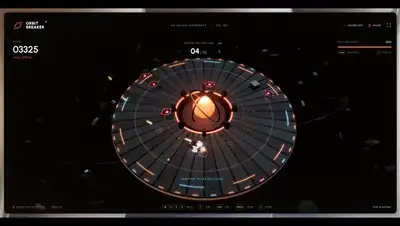</a><br><a href="https://www.sandbase.ai/lab/ai-videos/hy4-flash/2122590824466645483?lang=zh-CN&utm_source=github&utm_medium=readme&utm_campaign=awesome-hy4-flash&utm_content=card"><b>可游玩的3D网页街机射击游戏</b></a><br><sub><a href="https://x.com/mikenevermiss/status/2122590824466645483">@mikenevermiss</a> · 1:00</sub></td><td width="33%" valign="top"><a href="https://www.sandbase.ai/lab/media/x/deepseek-v4-1-flash-1017/2122621650915246460/video.mp4">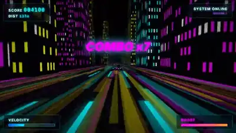</a><br><a href="https://www.sandbase.ai/lab/ai-videos/hy4-flash/2122621650915246460?lang=zh-CN&utm_source=github&utm_medium=readme&utm_campaign=awesome-hy4-flash&utm_content=card"><b>AI编写的赛博朋克赛车游戏</b></a><br><sub><a href="https://x.com/Allexa_AI/status/2122621650915246460">@Allexa_AI</a> · 0:24</sub></td></tr>
<tr><td width="33%" valign="top"><a href="https://www.sandbase.ai/lab/media/x/hy4-flash/2122724443231293891/video.mp4"></a><br><a href="https://www.sandbase.ai/lab/ai-videos/hy4-flash/2122724443231293891?lang=zh-CN&utm_source=github&utm_medium=readme&utm_campaign=awesome-hy4-flash&utm_content=card"><b>可破坏地形的轻量小游戏</b></a><br><sub><a href="https://x.com/loktar00/status/2122724443231293891">@loktar00</a> · 0:36</sub></td><td width="33%" valign="top"><a href="https://www.sandbase.ai/lab/media/x/hy4-flash/2122902579453800476/video.mp4"></a><br><a href="https://www.sandbase.ai/lab/ai-videos/hy4-flash/2122902579453800476?lang=zh-CN&utm_source=github&utm_medium=readme&utm_campaign=awesome-hy4-flash&utm_content=card"><b>基于 Three.js 构建的网页三维游戏</b></a><br><sub><a href="https://x.com/ai_for_success/status/2122902579453800476">@ai_for_success</a> · 0:35</sub></td><td width="33%" valign="top"><a href="https://www.sandbase.ai/lab/media/x/deepseek-v4-1-flash-1017/2122919755841757479/video.mp4">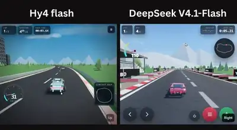</a><br><a href="https://www.sandbase.ai/lab/ai-videos/hy4-flash/2122919755841757479?lang=zh-CN&utm_source=github&utm_medium=readme&utm_campaign=awesome-hy4-flash&utm_content=card"><b>可试玩的三维赛车游戏</b></a><br><sub><a href="https://x.com/riyazmd774/status/2122919755841757479">@riyazmd774</a> · 0:40</sub></td></tr>
</table>

<details>
<summary><b>展开全部 7 条</b></summary>

<table>
<tr><td width="33%" valign="top"><a href="https://www.sandbase.ai/lab/media/x/hy4-flash/2123085293414916457/video.mp4">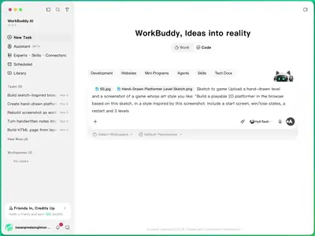</a><br><a href="https://www.sandbase.ai/lab/ai-videos/hy4-flash/2123085293414916457?lang=zh-CN&utm_source=github&utm_medium=readme&utm_campaign=awesome-hy4-flash&utm_content=card"><b>根据手绘草图生成的网页平台跳跃游戏</b></a><br><sub><a href="https://x.com/hasantoxr/status/2123085293414916457">@hasantoxr</a> · 0:56 · <a href="https://www.sandbase.ai/lab/ai-videos/hy4-flash/2123085293414916457?lang=zh-CN&utm_source=github&utm_medium=readme&utm_campaign=awesome-hy4-flash&utm_content=card">提示词</a></sub></td></tr>
</table>

</details>

<a id="explainer"></a>

## 讲解

<table>
<tr><td width="33%" valign="top"><a href="https://www.sandbase.ai/lab/media/x/hy4-flash/2122494161236451618/video.mp4"></a><br><a href="https://www.sandbase.ai/lab/ai-videos/hy4-flash/2122494161236451618?lang=zh-CN&utm_source=github&utm_medium=readme&utm_campaign=awesome-hy4-flash&utm_content=card"><b>AI行业新闻与监管动态播报</b></a><br><sub><a href="https://x.com/Romka2x/status/2122494161236451618">@Romka2x</a> · 2:28</sub></td></tr>
</table>

<a id="comparison"></a>

## 测试对比

<table>
<tr><td width="33%" valign="top"><a href="https://www.sandbase.ai/lab/media/x/hy4-flash/2122257048184455329/video.mp4">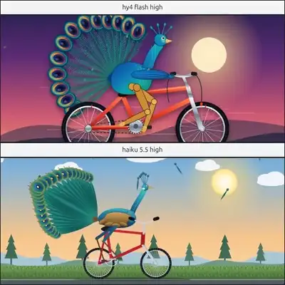</a><br><a href="https://www.sandbase.ai/lab/ai-videos/hy4-flash/2122257048184455329?lang=zh-CN&utm_source=github&utm_medium=readme&utm_campaign=awesome-hy4-flash&utm_content=card"><b>Hy4 Flash与Claude的孔雀SVG基准测试</b></a><br><sub><a href="https://x.com/SahilPanhotra/status/2122257048184455329">@SahilPanhotra</a> · 0:10</sub></td><td width="33%" valign="top"><a href="https://www.sandbase.ai/lab/media/x/hy4-flash/2122289623837896727/video.mp4">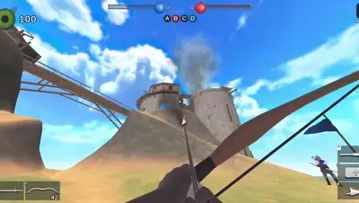</a><br><a href="https://www.sandbase.ai/lab/ai-videos/hy4-flash/2122289623837896727?lang=zh-CN&utm_source=github&utm_medium=readme&utm_campaign=awesome-hy4-flash&utm_content=card"><b>Hy4 Flash与Hy4模型游戏生成效果对比</b></a><br><sub><a href="https://x.com/kate_osita_/status/2122289623837896727">@kate_osita_</a> · 1:10</sub></td><td width="33%" valign="top"><a href="https://www.sandbase.ai/lab/media/x/hy4-flash/2122315149029826951/video.mp4">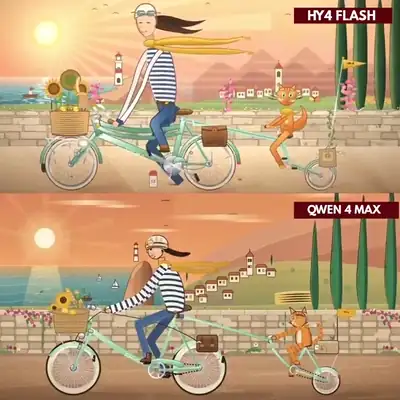</a><br><a href="https://www.sandbase.ai/lab/ai-videos/hy4-flash/2122315149029826951?lang=zh-CN&utm_source=github&utm_medium=readme&utm_campaign=awesome-hy4-flash&utm_content=card"><b>Hy4 Flash与Qwen 4 SVG动画对比</b></a><br><sub><a href="https://x.com/marcthecreatorr/status/2122315149029826951">@marcthecreatorr</a> · 0:12</sub></td></tr>
<tr><td width="33%" valign="top"><a href="https://www.sandbase.ai/lab/media/x/hy4-flash/2122415420665921735/video.mp4">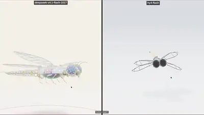</a><br><a href="https://www.sandbase.ai/lab/ai-videos/hy4-flash/2122415420665921735?lang=zh-CN&utm_source=github&utm_medium=readme&utm_campaign=awesome-hy4-flash&utm_content=card"><b>Hy4-Flash与DeepSeek-v4.1生成的机械蜻蜓对比</b></a><br><sub><a href="https://x.com/ItsmeAjayKV/status/2122415420665921735">@ItsmeAjayKV</a> · 0:34 · <a href="https://www.sandbase.ai/lab/ai-videos/hy4-flash/2122415420665921735?lang=zh-CN&utm_source=github&utm_medium=readme&utm_campaign=awesome-hy4-flash&utm_content=card">提示词</a></sub></td><td width="33%" valign="top"><a href="https://www.sandbase.ai/lab/media/x/hy4-flash/2122429321151435237/video.mp4">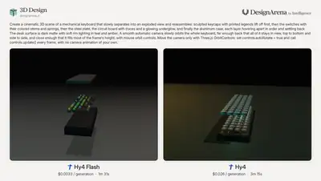</a><br><a href="https://www.sandbase.ai/lab/ai-videos/hy4-flash/2122429321151435237?lang=zh-CN&utm_source=github&utm_medium=readme&utm_campaign=awesome-hy4-flash&utm_content=card"><b>Hy4与Hy4-Flash生成的机械键盘拆解对比</b></a><br><sub><a href="https://x.com/DesignArena/status/2122429321151435237">@DesignArena</a> · 0:12 · <a href="https://www.sandbase.ai/lab/ai-videos/hy4-flash/2122429321151435237?lang=zh-CN&utm_source=github&utm_medium=readme&utm_campaign=awesome-hy4-flash&utm_content=card">提示词</a></sub></td><td width="33%" valign="top"><a href="https://www.sandbase.ai/lab/media/x/hy4-flash/2122450891613868137/video.mp4">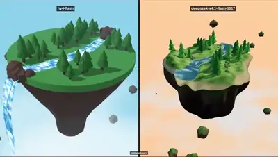</a><br><a href="https://www.sandbase.ai/lab/ai-videos/hy4-flash/2122450891613868137?lang=zh-CN&utm_source=github&utm_medium=readme&utm_campaign=awesome-hy4-flash&utm_content=card"><b>Three.js地形场景模型生成对比</b></a><br><sub><a href="https://x.com/ItsmeAjayKV/status/2122450891613868137">@ItsmeAjayKV</a> · 0:36</sub></td></tr>
</table>

<details>
<summary><b>展开全部 21 条</b></summary>

<table>
<tr><td width="33%" valign="top"><a href="https://www.sandbase.ai/lab/media/x/hy4-flash/2122481844578881884/video.mp4">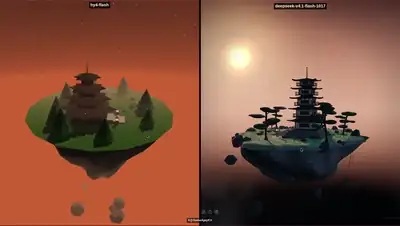</a><br><a href="https://www.sandbase.ai/lab/ai-videos/hy4-flash/2122481844578881884?lang=zh-CN&utm_source=github&utm_medium=readme&utm_campaign=awesome-hy4-flash&utm_content=card"><b>单次提示词模型生成效果对比</b></a><br><sub><a href="https://x.com/ItsmeAjayKV/status/2122481844578881884">@ItsmeAjayKV</a> · 0:36</sub></td><td width="33%" valign="top"><a href="https://www.sandbase.ai/lab/media/x/qwen4-max/2122484469215158409/video.mp4">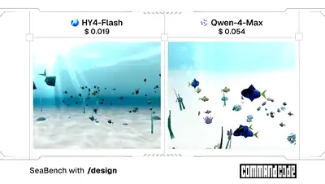</a><br><a href="https://www.sandbase.ai/lab/ai-videos/hy4-flash/2122484469215158409?lang=zh-CN&utm_source=github&utm_medium=readme&utm_campaign=awesome-hy4-flash&utm_content=card"><b>两款AI模型的3D视觉效果对比</b></a><br><sub><a href="https://x.com/naymur_dev/status/2122484469215158409">@naymur_dev</a> · 0:37</sub></td><td width="33%" valign="top"><a href="https://www.sandbase.ai/lab/media/x/deepseek-v4-1-flash-1017/2122493755697844338/video.mp4"></a><br><a href="https://www.sandbase.ai/lab/ai-videos/hy4-flash/2122493755697844338?lang=zh-CN&utm_source=github&utm_medium=readme&utm_campaign=awesome-hy4-flash&utm_content=card"><b>Hy4 Flash与DeepSeek V4.1 Flash对比</b></a><br><sub><a href="https://x.com/Jbm_dev/status/2122493755697844338">@Jbm_dev</a> · 1:03</sub></td></tr>
<tr><td width="33%" valign="top"><a href="https://www.sandbase.ai/lab/media/x/hy4-flash/2122502480592240816/video.mp4"></a><br><a href="https://www.sandbase.ai/lab/ai-videos/hy4-flash/2122502480592240816?lang=zh-CN&utm_source=github&utm_medium=readme&utm_campaign=awesome-hy4-flash&utm_content=card"><b>飞行汽车全3D动画模型对比</b></a><br><sub><a href="https://x.com/willwang_xx/status/2122502480592240816">@willwang_xx</a> · 0:37</sub></td><td width="33%" valign="top"><a href="https://www.sandbase.ai/lab/media/x/hy4-flash/2122596232237625472/video.mp4">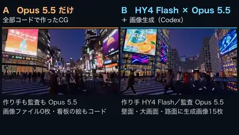</a><br><a href="https://www.sandbase.ai/lab/ai-videos/hy4-flash/2122596232237625472?lang=zh-CN&utm_source=github&utm_medium=readme&utm_campaign=awesome-hy4-flash&utm_content=card"><b>Three.js十字路口3D场景对比</b></a><br><sub><a href="https://x.com/K1sqttPHfC41982/status/2122596232237625472">@K1sqttPHfC41982</a> · 0:24</sub></td><td width="33%" valign="top"><a href="https://www.sandbase.ai/lab/media/x/deepseek-v4-1-flash-1017/2122624548076228895/video.mp4">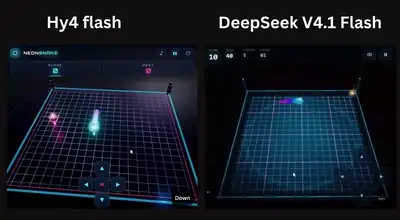</a><br><a href="https://www.sandbase.ai/lab/ai-videos/hy4-flash/2122624548076228895?lang=zh-CN&utm_source=github&utm_medium=readme&utm_campaign=awesome-hy4-flash&utm_content=card"><b>可游玩的3D贪吃蛇游戏对比</b></a><br><sub><a href="https://x.com/shabnam_774/status/2122624548076228895">@shabnam_774</a> · 0:37</sub></td></tr>
<tr><td width="33%" valign="top"><a href="https://www.sandbase.ai/lab/media/x/deepseek-v4-1-flash-1017/2122644820711645328/video.mp4">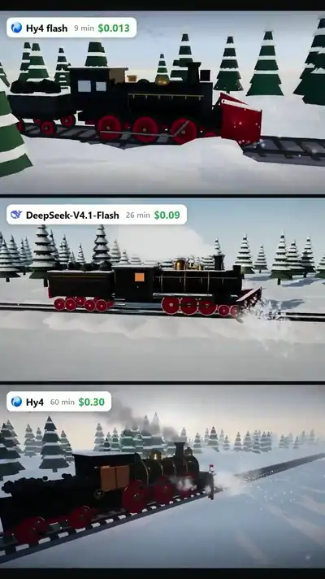</a><br><a href="https://www.sandbase.ai/lab/ai-videos/hy4-flash/2122644820711645328?lang=zh-CN&utm_source=github&utm_medium=readme&utm_campaign=awesome-hy4-flash&utm_content=card"><b>冬季铁路机车场景生成对比</b></a><br><sub><a href="https://x.com/0x_fokki/status/2122644820711645328">@0x_fokki</a> · 0:12</sub></td><td width="33%" valign="top"><a href="https://www.sandbase.ai/lab/media/x/hy4-flash/2122653322775769441/video.mp4">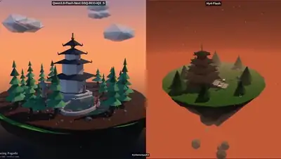</a><br><a href="https://www.sandbase.ai/lab/ai-videos/hy4-flash/2122653322775769441?lang=zh-CN&utm_source=github&utm_medium=readme&utm_campaign=awesome-hy4-flash&utm_content=card"><b>Qwen与Hy4 Flash模型生成对比</b></a><br><sub><a href="https://x.com/ItsmeAjayKV/status/2122653322775769441">@ItsmeAjayKV</a> · 0:34</sub></td><td width="33%" valign="top"><a href="https://www.sandbase.ai/lab/media/x/deepseek-v4-1-flash-1017/2122684074787778616/video.mp4">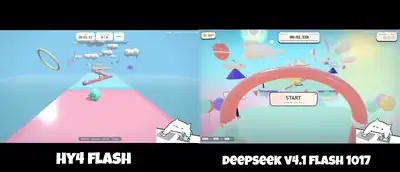</a><br><a href="https://www.sandbase.ai/lab/ai-videos/hy4-flash/2122684074787778616?lang=zh-CN&utm_source=github&utm_medium=readme&utm_campaign=awesome-hy4-flash&utm_content=card"><b>Hy4 Flash与DeepSeek生成对比</b></a><br><sub><a href="https://x.com/notjazii/status/2122684074787778616">@notjazii</a> · 0:22</sub></td></tr>
<tr><td width="33%" valign="top"><a href="https://www.sandbase.ai/lab/media/x/hy4-flash/2122728283208839285/video.mp4">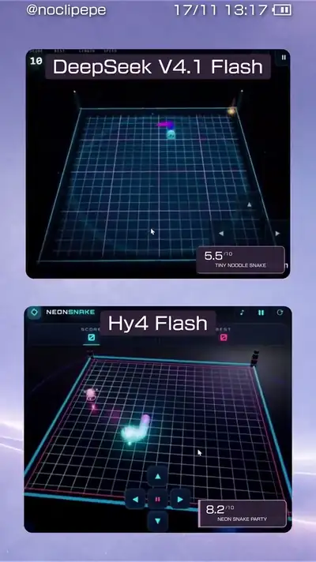</a><br><a href="https://www.sandbase.ai/lab/ai-videos/hy4-flash/2122728283208839285?lang=zh-CN&utm_source=github&utm_medium=readme&utm_campaign=awesome-hy4-flash&utm_content=card"><b>两款模型的3D贪吃蛇游戏对比</b></a><br><sub><a href="https://x.com/noclipepe/status/2122728283208839285">@noclipepe</a> · 0:41</sub></td><td width="33%" valign="top"><a href="https://www.sandbase.ai/lab/media/x/deepseek-v4-1-flash-1017/2122972249762455876/video.mp4">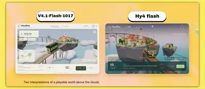</a><br><a href="https://www.sandbase.ai/lab/ai-videos/hy4-flash/2122972249762455876?lang=zh-CN&utm_source=github&utm_medium=readme&utm_campaign=awesome-hy4-flash&utm_content=card"><b>跨模型性能与成本效益对比评测</b></a><br><sub><a href="https://x.com/Parul_Gautam7/status/2122972249762455876">@Parul_Gautam7</a> · 0:07</sub></td><td width="33%" valign="top"><a href="https://www.sandbase.ai/lab/media/x/deepseek-v4-1-flash-1017/2122995650727985153/video.mp4">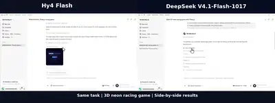</a><br><a href="https://www.sandbase.ai/lab/ai-videos/hy4-flash/2122995650727985153?lang=zh-CN&utm_source=github&utm_medium=readme&utm_campaign=awesome-hy4-flash&utm_content=card"><b>两款模型生成三维赛车游戏的对比测试</b></a><br><sub><a href="https://x.com/JacobyoungAI/status/2122995650727985153">@JacobyoungAI</a> · 0:33</sub></td></tr>
<tr><td width="33%" valign="top"><a href="https://www.sandbase.ai/lab/media/x/gemini-4-hydrogen/2123028120483901925/video.mp4">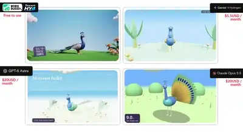</a><br><a href="https://www.sandbase.ai/lab/ai-videos/hy4-flash/2123028120483901925?lang=zh-CN&utm_source=github&utm_medium=readme&utm_campaign=awesome-hy4-flash&utm_content=card"><b>多模型孔雀舞动画生成效果对比</b></a><br><sub><a href="https://x.com/CodeByPoonam/status/2123028120483901925">@CodeByPoonam</a> · 0:15 · <a href="https://www.sandbase.ai/lab/ai-videos/hy4-flash/2123028120483901925?lang=zh-CN&utm_source=github&utm_medium=readme&utm_campaign=awesome-hy4-flash&utm_content=card">提示词</a></sub></td><td width="33%" valign="top"><a href="https://www.sandbase.ai/lab/media/x/deepseek-v4-1-flash-1017/2123085268416856398/video.mp4">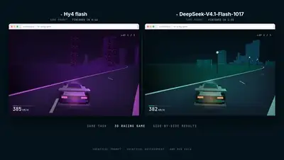</a><br><a href="https://www.sandbase.ai/lab/ai-videos/hy4-flash/2123085268416856398?lang=zh-CN&utm_source=github&utm_medium=readme&utm_campaign=awesome-hy4-flash&utm_content=card"><b>两款模型生成三维赛车游戏的对比</b></a><br><sub><a href="https://x.com/FellMentKE/status/2123085268416856398">@FellMentKE</a> · 0:20</sub></td><td width="33%" valign="top"><a href="https://www.sandbase.ai/lab/media/x/deepseek-v4-1-flash-1017/2123085937647505658/video.mp4">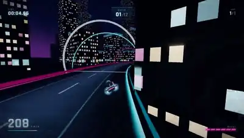</a><br><a href="https://www.sandbase.ai/lab/ai-videos/hy4-flash/2123085937647505658?lang=zh-CN&utm_source=github&utm_medium=readme&utm_campaign=awesome-hy4-flash&utm_content=card"><b>穿梭霓虹城市的气垫摩托竞速视频</b></a><br><sub><a href="https://x.com/n__deborah/status/2123085937647505658">@n__deborah</a> · 0:24</sub></td></tr>
</table>

</details>

**[在 SandBase Lab 查看全部 38 条 →](https://www.sandbase.ai/lab/ai-videos/hy4-flash?lang=zh-CN&utm_source=github&utm_medium=readme&utm_campaign=awesome-hy4-flash&utm_content=section)**

<a id="recreate"></a>

## 用 Hy4 Flash 复刻视频

[SandBase Lab](https://www.sandbase.ai/lab/ai-videos/hy4-flash?lang=zh-CN&utm_source=github&utm_medium=readme&utm_campaign=awesome-hy4-flash&utm_content=recreate) 的每个视频页都有 **复刻** 按钮：在 Lab 文本竞技场把帖子内容发给 Hy4 Flash，返回可在浏览器直接播放的代码。

用 API 的话，Hy4 Flash 在 SandBase 上的模型 ID 是 `tencent/hy4-flash`（兼容 OpenAI）。把提示词写进 `prompt.txt`，在 [控制台](https://www.sandbase.ai/console/keys?utm_source=github&utm_medium=readme&utm_campaign=awesome-hy4-flash) 创建 Key，然后运行：

```bash
jq -n --rawfile prompt prompt.txt \
  '{model: "tencent/hy4-flash", max_tokens: 64000, messages: [{role: "user", content: $prompt}]}' |
curl -sS --max-time 900 https://api.sandbase.ai/v1/chat/completions \
  -H "Authorization: Bearer $SANDBASE_API_KEY" \
  -H "Content-Type: application/json" \
  -d @- | jq -r '.choices[0].message.content' | sed '/^```/d' > hy4-flash.html
```

用浏览器打开 `hy4-flash.html`，或在 [SandBase Sandbox](https://www.sandbase.ai/landing/sandbox?utm_source=github&utm_medium=readme&utm_campaign=awesome-hy4-flash) 中运行，让生成的代码保持隔离。这个模型的 `max_tokens` 上限是 64000，所以上面的示例直接取该上限。完整步骤见 [教程](docs/zh-CN/tutorial.md)，价格见 [模型页](https://www.sandbase.ai/model/tencent/hy4-flash?utm_source=github&utm_medium=readme&utm_campaign=awesome-hy4-flash)。

<a id="faq"></a>

## 常见问题

### Hy4 Flash 是什么？

Hy4-Flash 是腾讯混元 Hy4 系列中性价比更高的一档，2026 年 11 月 16 日发布，参数量约为旗舰的四分之一。它接受文本和图片输入，上下文窗口约 1,048,576 token，支持推理、工具调用和结构化输出。在 SandBase 上它是 `tencent/hy4-flash`，标价为每百万输入 token $0.07、每百万输出 token $0.281。来源：`sandbase inspect tencent/hy4-flash`。

### 这些 Hy4 Flash 视频是怎么做出来的？

模型并不直接渲染视频。它写出一个网页（用 Three.js、SVG、Canvas 或 CSS 动画的 HTML），作者再把页面播放过程录下来。有作者不用 harness、一次生成，也有作者在同一提示词下和其他模型对比。见 [教程](docs/zh-CN/tutorial.md)。

### 在哪里找到视频的提示词？

标有 **提示词** 的视频，其 Lab 页面上有作者的提示词。[提示词索引](docs/zh-CN/prompts.md) 列出了全部。

### 怎么写好 Hy4 Flash 提示词？

指定输出一个独立的 HTML 文件，并说明用哪个渲染方式（Three.js、SVG、Canvas 或 CSS）；描述主体和运动，禁止外部素材。公开提示词的作者大多只写一个具体主体，比如一只机械蜻蜓，或一个逐层拆解的键盘。详细写法和模板见 [提示词写法](docs/zh-CN/prompt-guide.md)。

### 怎么调用 Hy4 Flash API？

在 SandBase 上模型 ID 是 `tencent/hy4-flash`，使用兼容 OpenAI 的 `/v1/chat/completions` 接口，一个 Key 调用所有模型。见 [复刻](#recreate) 和 [模型页](https://www.sandbase.ai/model/tencent/hy4-flash?utm_source=github&utm_medium=readme&utm_campaign=awesome-hy4-flash)。

### Hy4 Flash 比 DeepSeek V4.1 Flash 1017、Claude Opus 5.5 或 Hy4 更强吗？

目前没有实测结论。来源资料里没有 Hy4 Flash 的 Lab Evals 或 Pelican Test 数据，所以这里不引用任何基准分数。创作者的证据是单次生成、且结论不一：一位作者在机械蜻蜓测试中认为 DeepSeek V4.1 Flash 1017 更有机械感，并称 Hy4 Flash 更简单；DesignArena 则报告，同一个 3D 提示词下，更大的 Hy4 细节更丰富。详见 [模型对比](docs/zh-CN/model-comparison.md)。

### 做一个视频要花多少钱？

SandBase 标价为每百万输入 token $0.07、每百万输出 token $0.281，每百万缓存输入 token $0.003。也有创作者报告在 WorkBuddy 中免费使用 Hy4 Flash。推理 token 按输出计费。来源：`sandbase inspect tencent/hy4-flash`。

### 可以转用这些视频吗？

默认不可以，视频归作者所有。见 [MEDIA-RIGHTS](MEDIA-RIGHTS.md)。

<a id="contribute"></a>

## 推荐作品

发现了应该收录的 Hy4 Flash 作品？附上 X 原帖 [提交给我们](https://github.com/sandbase-lab/awesome-hy4-flash/issues/new?template=submit-video.yml)。通过后会先加入 SandBase Lab，下一次每日同步时出现在这里。觉得有用的话，点个 ⭐ 能让更多人看到。

## 致谢与权利

所有视频、提示词和帖子归作者所有。每张卡片都注明作者并链接原帖。MIT 许可证只覆盖本仓库的脚本。更正署名或下架视频请见 [MEDIA-RIGHTS](MEDIA-RIGHTS.md)。

与腾讯混元（Tencent Hunyuan）无隶属或背书关系。

---

由 [SandBase Lab](https://www.sandbase.ai/lab/?lang=zh-CN&utm_source=github&utm_medium=readme&utm_campaign=awesome-hy4-flash) 维护 · [全部 AI 视频合集](https://www.sandbase.ai/lab/ai-videos?lang=zh-CN&utm_source=github&utm_medium=readme&utm_campaign=awesome-hy4-flash)
